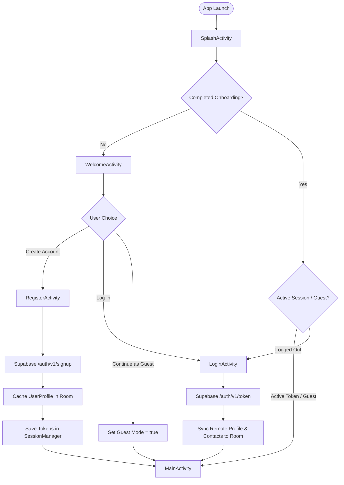

# BLACKOUT — Authentication Implementation Architecture (Phase 9.5)

## 1. Executive Summary

Phase 9.5 establishes a unified, cross-platform authentication, session management, and role-based access control (RBAC) architecture across the BLACKOUT ecosystem. It connects the **Native Android application (Java 11 + XML)**, the **Emergency Operations Command Portal (React + Vite + TypeScript)**, and the **Supabase PostgreSQL backend** under a single identity perimeter.

Crucially, BLACKOUT enforces an uncompromised life-safety tenet: **SOS beacon generation, offline Room database persistence, and Google Nearby Connections P2P store-carry-and-forward mesh networking function unconditionally without user login, onboarding completion, or internet connectivity.**

---

## 2. Authentication Flow & State Architecture



---

## 3. Native Android Component Specifications

### 3.1 SplashActivity (`com.blackout.emergency.activities.SplashActivity`)
- **Role**: Application entry point (`android.intent.action.MAIN` / `android.intent.category.LAUNCHER`).
- **Functionality**:
  - Displays tactical branding and emergency logo with smooth fade-in animation.
  - Inspects `SessionManager.hasCompletedOnboarding()`, `SessionManager.isLoggedIn()`, and `SessionManager.isGuestMode()`.
  - Intelligently routes first-time users to `WelcomeActivity`, returning authenticated or guest users to `MainActivity`, and signed-out users to `LoginActivity`.

### 3.2 WelcomeActivity (`com.blackout.emergency.activities.WelcomeActivity`)
- **Role**: Educational onboarding and emergency protocol orientation.
- **Pillars Presented**:
  1. **Instant Offline SOS**: Transmit distress beacons with GPS coordinates without cellular or data signals.
  2. **Device-to-Device Mesh Relay**: Google Nearby Connections multi-hop store-carry-and-forward network across peer smartphones.
  3. **Cryptographically Signed Warnings**: Civil defense warnings verified locally via Ed25519 digital signatures.
- **Entry Points**:
  - `CREATE ACCOUNT`: Launches `RegisterActivity`.
  - `LOG IN`: Launches `LoginActivity`.
  - `CONTINUE AS GUEST (OFFLINE SOS READY)`: Immediately flags onboarding as complete, sets guest mode to `true`, and jumps straight into `MainActivity`.

### 3.3 RegisterActivity (`com.blackout.emergency.activities.RegisterActivity`)
- **Role**: Citizen registration and account provisioning.
- **Fields & Validations**:
  - Full Name (required, non-blank).
  - Email Address (RFC 5322 validation via `Patterns.EMAIL_ADDRESS`).
  - Phone Number (optional for profile, formatted for emergency SMS dispatch).
  - Password (minimum 8 characters, password visibility toggle).
  - Confirm Password (strict equality check).
  - Terms Checkbox (explicit acknowledgment of emergency protocol policies).
- **Backend Handshake**:
  - Calls `SupabaseAuthClient.signUp(email, password, fullName, phone, callback)`.
  - Ingests user identity to Supabase GoTrue Auth and automatically triggers database profile creation via `on_auth_user_created` PostgreSQL trigger.
  - Saves returned access JWT and refresh token to `SessionManager`.
  - Persists `UserProfileEntity` in local Room database for full offline inspection.

### 3.4 LoginActivity (`com.blackout.emergency.activities.LoginActivity`)
- **Role**: Authenticated session establishment and cloud synchronization.
- **Functionality**:
  - Authenticates against Supabase `/auth/v1/token?grant_type=password`.
  - Stores credentials securely in `SessionManager`.
  - Initiates background synchronization: fetches user profile and emergency contacts from Supabase REST endpoints and stores them into the local Room database.
  - Provides direct links to `ForgotPasswordActivity`, `RegisterActivity`, and immediate `Continue as Guest`.

### 3.5 ForgotPasswordActivity (`com.blackout.emergency.activities.ForgotPasswordActivity`)
- **Role**: Self-service account recovery.
- **Functionality**:
  - Validates registered email address.
  - Dispatches recovery request to Supabase `/auth/v1/recover`.
  - Displays affirmative tactical success card confirming email dispatch.

### 3.6 SessionManager (`com.blackout.emergency.auth.SessionManager`)
- **Role**: Centralized thread-safe singleton managing authentication state.
- **Storage**: Backed by private `SharedPreferences` (`blackout_auth_session`).
- **State Managed**:
  - `auth_access_token`: Supabase JWT bearer token for authorized REST API calls.
  - `auth_refresh_token`: OAuth2 refresh token.
  - `auth_user_id`: UUID of the authenticated user.
  - `auth_user_email`: Email address.
  - `auth_user_name`: Cached full display name.
  - `auth_user_role`: System role (default `'CITIZEN'`).
  - `auth_is_guest`: Boolean indicating whether the user is in unauthenticated Guest mode.
  - `auth_onboarding_completed`: Boolean recording onboarding completion.

---

## 4. Web Command Center Role Enforcement

The React Operations Portal serves emergency personnel: Control Room Operators, Field Coordinators, Warning Publishers, and Super Administrators. Citizen accounts created on mobile must not access operational dashboards.

In `web/src/services/authService.ts`:
```typescript
if (!error && data?.user) {
  const profile = await this.getUserProfile(data.user.id, data.user.email);
  if (profile) {
    if (profile.role === 'CITIZEN') {
      await supabase.auth.signOut();
      return {
        profile: null,
        error: 'Access Restricted: Citizen accounts are not authorized to access the Emergency Operations Command Center. Please use the BLACKOUT Android mobile application.',
      };
    }
    // Proceed with operator session
  }
}
```

This ensures strict role isolation and prevents unauthorized exposure of tactical emergency incident data.

