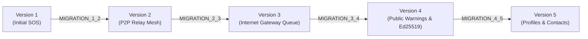

# BLACKOUT — Database Migration Ledger & Schema Evolution (Phase 9.5)

## 1. Overview & Non-Destructive Principles

BLACKOUT's data persistence layer operates in two tiers:
1. **On-Device SQLite / Room Database** (offline storage for distress beacons, pending uploads, verified warnings, responder profiles, and emergency contacts).
2. **Central Supabase PostgreSQL Database** (authoritative civil defense cloud store).

To ensure zero data loss during production upgrades, every migration is strictly non-destructive (`CREATE TABLE IF NOT EXISTS`, `ALTER TABLE ... ADD COLUMN`, `CREATE INDEX IF NOT EXISTS`).

---

## 2. Android Room Migration Ledger



### 2.1 `MIGRATION_1_2` (Phase 4 Relay Infrastructure)
- **Scope**: Adds relay payload tracking to handle store-carry-and-forward mesh operations.
- **Tables Affected**: `emergency_messages` (adds relay tracking attributes).

### 2.2 `MIGRATION_2_3` (Phase 5 Gateway Queue)
- **Scope**: Introduces pending uploads queue for cellular/Wi-Fi gateway draining.
- **DDL Executed**:
  ```sql
  CREATE TABLE IF NOT EXISTS pending_uploads (
      messageId TEXT NOT NULL PRIMARY KEY,
      uploadStatus TEXT,
      gatewayDeviceId TEXT,
      attemptCount INTEGER NOT NULL,
      nextAttemptAt INTEGER NOT NULL,
      lastAttemptAt INTEGER NOT NULL,
      uploadedAt INTEGER NOT NULL,
      backendReference TEXT,
      lastErrorCode TEXT
  );
  CREATE INDEX IF NOT EXISTS index_pending_uploads_uploadStatus ON pending_uploads (uploadStatus);
  CREATE INDEX IF NOT EXISTS index_pending_uploads_nextAttemptAt ON pending_uploads (nextAttemptAt);
  ```

### 2.3 `MIGRATION_3_4` (Phase 7 Digitally Signed Public Warnings)
- **Scope**: Installs public warnings, versioned revisions, trusted public key registry, and relay logs.
- **Tables Created**:
  1. `public_warnings`: Active civil defense warnings with canonical payloads and Ed25519 signatures.
  2. `warning_revisions`: Historic revisions for warning lifecycle tracking.
  3. `trusted_signing_keys`: Registered Ed25519 public keys for offline verification.
  4. `warning_relay_history`: Deduplication ledger for device-to-device mesh forwarding.
  5. `warning_sync_state`: Gateway synchronization checkpoints.
  6. `warning_revocations`: Revoked warning registry.

### 2.4 `MIGRATION_4_5` (Phase 9.5 Profiles & Emergency Contacts)
- **Scope**: Adds user profile caching and In-Case-of-Emergency (ICE) contact storage.
- **DDL Executed**:
  ```sql
  CREATE TABLE IF NOT EXISTS user_profiles (
      userId TEXT NOT NULL PRIMARY KEY,
      email TEXT,
      fullName TEXT,
      role TEXT,
      phone TEXT,
      bloodType TEXT,
      country TEXT,
      preferredLanguage TEXT,
      medicalNotes TEXT,
      updatedAt INTEGER NOT NULL
  );

  CREATE TABLE IF NOT EXISTS emergency_contacts (
      id TEXT NOT NULL PRIMARY KEY,
      userId TEXT NOT NULL,
      contactName TEXT,
      contactPhone TEXT,
      relationship TEXT,
      isPrimary INTEGER NOT NULL DEFAULT 0,
      createdAt INTEGER NOT NULL,
      updatedAt INTEGER NOT NULL
  );
  CREATE INDEX IF NOT EXISTS index_emergency_contacts_userId ON emergency_contacts (userId);
  CREATE INDEX IF NOT EXISTS index_emergency_contacts_isPrimary ON emergency_contacts (isPrimary);
  ```

---

## 3. Supabase PostgreSQL Migration Ledger

### 3.1 Migration `20261101030000_phase9_geoapify_and_sms.sql`
- Adds reverse geocoding attributes to `emergency_alerts` (`formatted_address`, `locality`, `district`, `state`, `country`, `postal_code`, `is_approximate_address`).
- Creates `sms_notifications` ledger table for auditing SMS alert dispatches.

### 3.2 Migration `20261101040000_phase9_5_auth_and_profiles.sql`
- **Role Enum Expansion**: Safely appends `'CITIZEN'` to `app_role_enum`.
- **User Profile Columns**: Adds `phone`, `blood_type`, `country`, `preferred_language`, `medical_notes` to `public.user_profiles`.
- **Table Creation**:
  ```sql
  CREATE TABLE IF NOT EXISTS public.emergency_contacts (
      id UUID PRIMARY KEY DEFAULT gen_random_uuid(),
      user_id UUID NOT NULL REFERENCES auth.users(id) ON DELETE CASCADE,
      contact_name TEXT NOT NULL,
      contact_phone TEXT NOT NULL,
      relationship TEXT DEFAULT 'Contact',
      is_primary BOOLEAN NOT NULL DEFAULT false,
      created_at TIMESTAMPTZ NOT NULL DEFAULT now(),
      updated_at TIMESTAMPTZ NOT NULL DEFAULT now()
  );
  ```
- **Row Level Security (RLS)**:
  - Users can SELECT, INSERT, UPDATE, and DELETE only their own emergency contacts (`user_id = auth.uid()`).
  - Command Center Operators can SELECT emergency contacts associated with distressed alerts for emergency notification dispatch.
- **Trigger**: `public.handle_new_user()` provisions a default `'CITIZEN'` profile upon user creation in `auth.users`.

