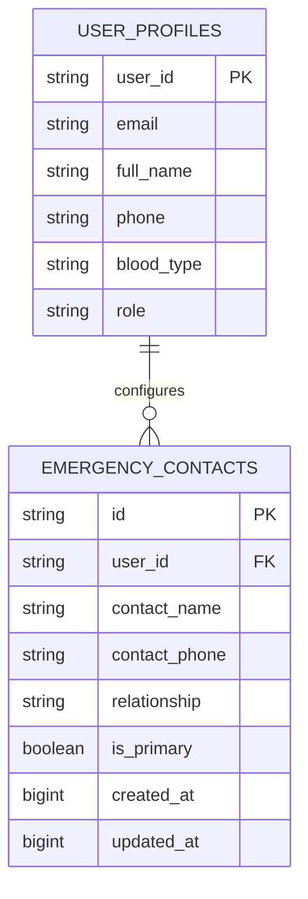

# BLACKOUT — Emergency Contacts (ICE) Architecture & Management (Phase 9.5)

## 1. Subsystem Overview

The Emergency Contacts (In Case of Emergency - ICE) subsystem enables citizens and responders to designate trusted individuals (family members, spouses, physicians, guardians) to be alerted when life-threatening emergencies occur.

The subsystem operates with **offline-first local persistence** using Android Room database (v5) and synchronizes with the central Supabase PostgreSQL store whenever online connectivity is detected.

---

## 2. Data Architecture & Relational Mapping

### 2.1 Schema Attributes

| Column Name | SQLite Data Type (Room) | PostgreSQL Data Type (Supabase) | Description |
|---|---|---|---|
| `id` | `TEXT PRIMARY KEY` | `UUID PRIMARY KEY DEFAULT gen_random_uuid()` | Unique contact identifier |
| `user_id` | `TEXT NOT NULL` | `UUID REFERENCES auth.users(id) ON DELETE CASCADE` | Foreign key referencing contact owner |
| `contact_name` | `TEXT NOT NULL` | `TEXT NOT NULL` | Legal name of emergency contact |
| `contact_phone` | `TEXT NOT NULL` | `TEXT NOT NULL` | E.164 phone number (e.g., `+91 9876543210`) |
| `relationship` | `TEXT` | `TEXT` | Relationship tag (`Spouse`, `Parent`, `Doctor`, `Friend`) |
| `is_primary` | `INTEGER NOT NULL DEFAULT 0` | `BOOLEAN NOT NULL DEFAULT false` | Designates highest priority recipient |
| `created_at` | `INTEGER` | `TIMESTAMPTZ DEFAULT now()` | Creation timestamp |
| `updated_at` | `INTEGER` | `TIMESTAMPTZ DEFAULT now()` | Last modification timestamp |

---

## 3. Offline & Sync Operations

1. **Offline Persistence**:
   - Every contact created, edited, or deleted is committed immediately to SQLite via `EmergencyContactDao`.
   - Guest users (without a Supabase account) can configure contacts locally on-device. Contacts remain preserved across application restarts.
2. **Cloud Synchronization**:
   - When authenticated, any addition or modification is forwarded to Supabase GoTrue REST endpoint `/rest/v1/emergency_contacts`.
   - On login, `LoginActivity` triggers an automatic pull of the user's remote contacts, populating the local Room database.
3. **Emergency Dispatch Safety Tenet**:
   - In an emergency blackout, contacts are stored locally and will be relayed over Google Nearby Connections P2P mesh.
   - When a node encounters an Internet Gateway or cellular coverage, primary contacts receive automated notifications via the BLACKOUT SMS notification subsystem (`/functions/v1/notifications-sms`).
   - The UI never claims an SMS was delivered when offline; status explicitly indicates "Queued for gateway reachability".

---

## 4. UI Component Architecture

- **`EmergencyContactsActivity.java`**:
  - Displays list of configured contacts with badges highlighting the `PRIMARY` contact.
  - Displays tactical empty state when zero contacts are present, encouraging the user to set up their safety network.
  - Floating action button opens the Material dialog.
- **`dialog_add_contact.xml`**:
  - Validates contact name and phone number.
  - Radio/Checkbox allows designating the contact as Primary.
- **`EmergencyContactAdapter.java`**:
  - High-performance RecyclerView adapter with smooth action dispatching (`onEdit`, `onDelete`).
