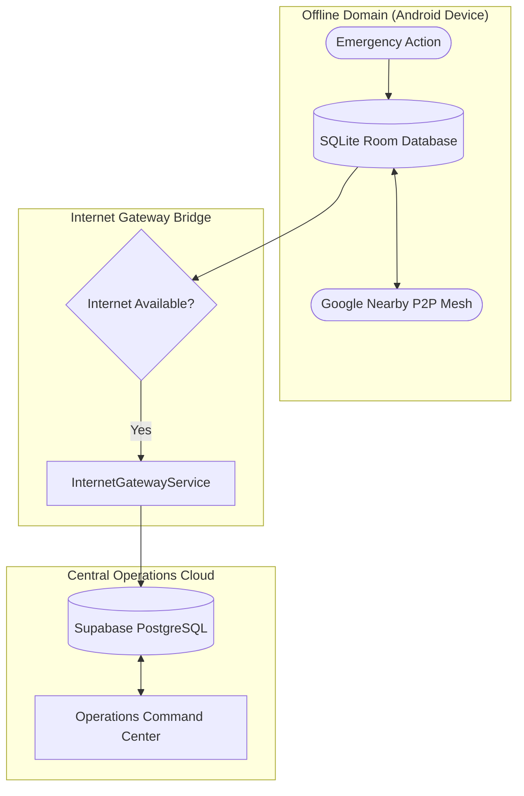

# BLACKOUT — Offline Synchronization Architecture (Phase 9.5)

## 1. Core Synchronization Philosophy

In catastrophic disasters—hurricanes, grid collapses, seismic events—telecommunications and electrical infrastructure fail entirely. BLACKOUT is engineered from the ground up on the **Offline-First Resilience Principle**:

> **Every core life-safety capability—SOS beacon creation, tactical mesh broadcasting, warning reception, cryptographic signature verification, responder medical profiling, and emergency contact lookup—must function at 100% operational capacity on-device with zero internet connectivity.**

---

## 2. Synchronization Subsystems & Conflict Protocols

---

## 3. Subsystem Breakdown

### 3.1 Distress Beacons & Incident Ingestion
1. **Offline Capture**: The instant a user taps "TRIGGER SOS BEACON", a distress record is generated with hardware GPS coordinates, emergency category, and medical telemetry, and committed to Room.
2. **Pending Uploads Queue**: The message is inserted into `pending_uploads` with status `'PENDING'`.
3. **P2P Multi-Hop Relay**: Concurrently, the beacon is serialized into a compact JSON payload and broadcasted to neighboring peer nodes via Google Nearby Connections (hop limit: 7).
4. **Opportunistic Cloud Ingestion**:
   - Any device in the mesh with internet access acts as a Gateway.
   - `InternetGatewayService` drains pending alerts via exponential backoff (1s, 2s, 4s, up to 60s).
   - Ingestion is deduplicated at the Supabase database layer via `message_id` unique constraint.

### 3.2 Public Warning Distribution & Verification
1. **Authoritative Broadcast**: Emergency authorities sign warnings with private Ed25519 keys via the Operations Portal.
2. **Offline Relay**: Received warnings are verified locally by Android nodes using Bouncy Castle against trusted public keys stored in Room.
3. **Revision Resolution**: If a warning arrives with a higher revision number for the same `warningId`, Room updates the active warning and archives the previous state to `warning_revisions`.
4. **Revocation Authority**: If a revocation packet is received, the warning is immediately marked `'REVOKED'`, and local alarms are suppressed.

### 3.3 User Profile & Emergency Contacts
1. **Local-First Writes**: Profile updates (blood group, medical notes, phone, language) and emergency contacts are written to Room immediately.
2. **Cloud Uplink**:
   - When authenticated and connected, `SupabaseAuthClient` posts updates to `/rest/v1/user_profiles` and `/rest/v1/emergency_contacts`.
   - On new device login, remote profiles and contacts are pulled from Supabase and populated into Room.
3. **Conflict Policy**: Last-Write-Wins (LWW) utilizing the monotonic `updated_at` millisecond timestamp.

---

## 4. Bandwidth & Power Conservation

- **Adaptive Mesh Duty Cycle**: P2P discovery modulates radio cycles based on battery state and peer density.
- **Payload Minimization**: Nearby Connections payloads avoid redundant envelope data, keeping single-packet transfers under standard MTU thresholds.
- **WorkManager Scheduling**: Background warning synchronization runs via `PeriodicWorkRequest` configured with `NetworkType.CONNECTED` constraints to preserve battery.

