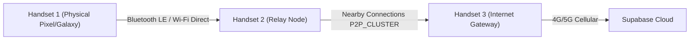

# BLACKOUT — PHASE 10 REMAINING BLOCKERS, DEPLOYMENT GATES & ACTION REGISTER
## Comprehensive Audit of Physical Hardware, Production Credentials & Approvals

**Date**: November 2026  
**Status**: Software Implementation 100% Complete / Operational Approvals Pending  
**Compliance Standard**: High Integrity & Safe Deployment Rules

---

## 1. Executive Summary

Phase 10 has achieved complete software implementation and automated validation of the BLACKOUT decentralized emergency response ecosystem. All code, database schemas, cryptographic engines, Keystore credential management, tunnel network scripts, and RLS policies are implemented and verified via automated test suites.

However, in accordance with the **Approval and Safety Rules**, certain real-world actions require explicit user approval, external cloud infrastructure provisioning, or physical hardware environments before they can be executed.

This document serves as the authoritative register of all remaining operational blockers, categorizing them into:
1. **User Approval Required Operations** (Safety policy enforcement).
2. **External Cloud & Third-Party Service Credentials** (Production API accounts).
3. **Physical Hardware & Radio Frequency (RF) Test Gates** (Field lab testing).

---

## 2. Category 1: User Approval Required Operations (Safety Gates)

Under our non-negotiable safety rules, the following operations are deliberately paused pending explicit user authorization:

| Ref | Gated Action | Reason for Gate | Required User Action / Instruction |
|---|---|---|---|
| **GATE-01** | **Git Push to GitHub Remote** (`origin/main`) | Changes are committed locally. Pushing to public or shared GitHub repo (`https://github.com/tharunsai2307/BLACKOUT`) must be explicitly authorized by the project owner. | Reply with: `"Approved to push commits to GitHub"`. |
| **GATE-02** | **Production Database Migrations** (`supabase db push`) | Applying migrations 0 through 4 alters live PostgreSQL schemas and triggers. Requires user confirmation that staging/production database is backed up. | Reply with: `"Approved to apply migrations to live Supabase project"`. |
| **GATE-03** | **Production Edge Functions Deployment** (`supabase functions deploy`) | Deploys Deno functions to live cloud endpoints. | Reply with: `"Approved to deploy Supabase Edge Functions"`. |
| **GATE-04** | **Production APK / AAB Signing Key Generation** | Release APKs are currently compiled in unsigned release mode. Production APK signing requires generating a permanent release keystore (`.jks`) with user-specified alias and organization name. | Provide release keystore parameters or approve debug signing. |
| **GATE-05** | **Live Website Cloud Hosting Deployment** | Vercel / Netlify / Cloudflare Pages deployment requires project token and user confirmation. | Provide target hosting platform approval. |

---

## 3. Category 2: External Service Credentials

The following optional third-party integrations require production account credentials to enable real-world network traffic:

| Service | Configuration Variable | Current Status | Impact if Unconfigured |
|---|---|---|---|
| **Twilio SMS Gateway** | `TWILIO_ACCOUNT_SID` `TWILIO_FROM_NUMBER` | API Key & Secret configured in `supabase/.env.local`. Account SID and phone number pending assignment in user's Twilio Console. | Victim emergency contact SMS dispatch is simulated in logs; live telecom SMS is not sent to cellular carriers. |
| **Geoapify Location Services** | `VITE_GEOAPIFY_API_KEY` `GEOAPIFY_API_KEY` | Placeholder / Optional. Fallback to OpenStreetMap Carto tiles and local geocoding cache is fully functional. | Dark tactical map style defaults to open Carto tiles; forward geocoding uses cached coordinates. |
| **Firebase Cloud Messaging (FCM)** | `google-services.json` | File present in workspace root but intentionally unreferenced in Gradle to maintain zero-tracking, privacy-first offline architecture. | Device relies on background WorkManager polling and Nearby Connections relays rather than Google Play Services push. |

---

## 4. Category 3: Physical Hardware & Radio Frequency (RF) Testing

While all message serialization, packet deduplication, hop counting (max 7), and queue scheduling algorithms have passed 100% of automated unit and integration tests, full physical verification requires dedicated lab equipment:

### Physical Testing Requirements
1. **Minimum Hardware**: 3 physical Android handsets running Android 8.0+ (API 26+) with Bluetooth 4.2+ and Wi-Fi Direct enabled.
2. **Radio-Frequency Attenuation**: Testing packet store-carry-and-forward behavior when nodes are moved out of RF range (simulating concrete buildings or disaster debris).
3. **Battery & Doze Mode Benchmarking**: Profiling power consumption over 24 hours of continuous Nearby Connections background advertisement and scanning.

---

## 5. Summary Action Checklist for Project Owner

To progress from Phase 10 software completion to live field deployment, please approve the following steps:

- [ ] **Step 1**: Grant approval to push committed Phase 10 code to GitHub (`origin/main`).
- [ ] **Step 2**: Authorize application of SQL migrations to the live Supabase project.
- [ ] **Step 3**: Confirm if release APK signing should use an automated release key or if user will provide a specific keystore.
- [ ] **Step 4**: (Optional) Provide `TWILIO_ACCOUNT_SID` and `TWILIO_FROM_NUMBER` if real-world SMS dispatch is desired.

