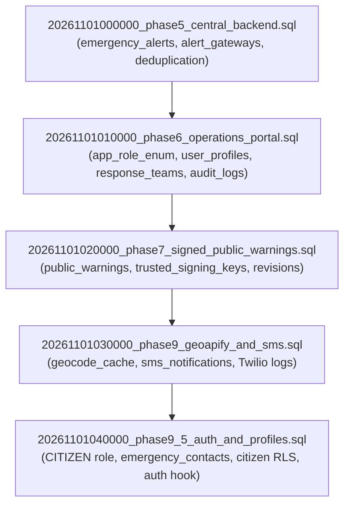

# BLACKOUT — SUPABASE PROJECT SETUP & INFRASTRUCTURE INTEGRATION GUIDE
## Live Backend Configuration, Secret Isolation & Tunnel Network Architecture (Phase 10)

**Date**: November 2026  
**Project**: BLACKOUT Decentralized Emergency Response Platform  
**Target Environment**: Supabase Cloud / Self-Hosted PostgreSQL 15+ & Deno Edge Functions

---

## 1. Credentials & Secret Isolation Architecture

The BLACKOUT ecosystem requires two distinct tiers of API credentials provided by Supabase:

```
+---------------------------------------------------------------------------------------------+
|                                    CREDENTIAL MAPPING                                       |
+---------------------------------------------------------------------------------------------+
| Credential Type      | Key Value                                | Target Location           |
+----------------------+------------------------------------------+---------------------------+
| Publishable / Anon   | sb_publishable_i4TteJdAqTwsjaoohkC18g_fmW7EW2E | web/.env (VITE_)          |
|                      |                                          | Constants.java (Android)  |
|                      |                                          | web/.env.example          |
+----------------------+------------------------------------------+---------------------------+
| Service Role Secret  | sb_secret_***REDACTED***                 | supabase/.env.local       |
| (Administrative Key) |                                          | (Edge Functions / CLI)    |
|                      |                                          | STRICT QUARANTINE:        |
|                      |                                          | NEVER IN APK OR WEB VITE  |
+----------------------+------------------------------------------+---------------------------+
```

### 1.1 The Golden Security Rule
- **The Publishable / Anon Key** is intended for client applications. It is strictly constrained by PostgreSQL Row-Level Security (RLS) policies.
- **The Service-Role Secret Key** grants full administrative bypass of PostgreSQL Row-Level Security.
  > [!CAUTION]
  > Under no circumstances may `sb_secret_...` be compiled into the Android APK, included in Git commits, or prefixed with `VITE_` in client JavaScript bundles. It is strictly quarantined to `supabase/.env.local` for server-side execution.

---

## 2. Supabase Database Migration Sequence

All database migrations in `supabase/migrations/` must be applied in exact chronological sequence. Each migration is self-contained and idempotent:



### 2.1 Applying Migrations to Supabase Cloud
Using the Supabase CLI:
```bash
# Link local project to Supabase Cloud Project
supabase link --project-ref <your-project-ref>

# Push migrations to remote database
supabase db push

# Verify migration status
supabase migration list
```

Alternatively, apply the SQL files in order (0 -> 1 -> 2 -> 3 -> 4) through the Supabase Dashboard SQL Editor.

---

## 3. Edge Functions Configuration

BLACKOUT utilizes 4 core Deno-based Edge Functions in `supabase/functions/`:

1. `emergency-alerts`:
   - Endpoint: `POST /functions/v1/emergency-alerts`
   - Purpose: Ingests SOS messages forwarded by Android mobile gateways.
   - Headers: `apikey: <anon_key>`, `Authorization: Bearer <anon_key>`, `x-gateway-device-id: <callsign>`.
   - Security: Validates protocol version, UUID syntax, payload bounds, computes canonical SHA-256 hash, and deduplicates repeated packet transmissions.
2. `warnings`:
   - Endpoint: `GET /functions/v1/warnings`, `POST /functions/v1/warnings`
   - Purpose: Distributes verified Ed25519 warnings and trusted signing key updates to mobile clients and portals.
3. `geocode`:
   - Endpoint: `POST /functions/v1/geocode`
   - Purpose: Reverse geocodes incident GPS coordinates to human-readable addresses using cached Geoapify queries.
4. `notifications-sms`:
   - Endpoint: `POST /functions/v1/notifications-sms`
   - Purpose: Dispatches Twilio SMS notifications to victim emergency contacts during verified rescues.

### 3.1 Deploying Functions & Secrets
```bash
# Set secrets in Supabase Cloud
supabase secrets set SUPABASE_SERVICE_ROLE_KEY=your_supabase_service_role_key
supabase secrets set TWILIO_API_KEY_SID=your_twilio_api_key_sid
supabase secrets set TWILIO_API_SECRET=your_twilio_api_secret

# Deploy edge functions
supabase functions deploy emergency-alerts --no-verify-jwt
supabase functions deploy warnings
supabase functions deploy geocode
supabase functions deploy notifications-sms
```

---

## 4. Realtime Subscription Configuration

To enable instant dashboard updates without page reloads, enable Supabase Realtime replication on the following tables in the Supabase Dashboard (`Database` -> `Replication`):
- `emergency_alerts` (for incoming citizen SOS alerts and status updates)
- `public_warnings` (for real-time warning distribution)
- `response_teams` (for unit availability tracking)

---

## 5. Tunnel Network Architecture (Cross-Platform Mobile Testing)

When developing or testing locally, mobile devices (emulators or physical phones) must be able to reach the local workstation's Vite web portal (port 3000) and Supabase services.

```
+---------------------------------------------------------------------------------------------------+
|                                  TUNNEL NETWORK TOPOLOGY                                          |
+---------------------------------------------------------------------------------------------------+
| Device Type           | Connection Vector             | Target URL Endpoint                       |
+-----------------------+-------------------------------+-------------------------------------------+
| Local Browser         | Workstation Loopback          | http://localhost:3000                     |
| Android Emulator      | QEMU Host Gateway             | http://10.0.2.2:3000                      |
| Android Physical (USB)| ADB Reverse Port Forwarding   | http://localhost:3000 (via adb reverse)   |
| Android Physical (LAN)| Shared Local Wi-Fi Network    | http://192.168.29.178:3000                |
| Android (Cellular/4G) | Public HTTPS Tunnel           | https://blackout-ops.loca.lt              |
+---------------------------------------------------------------------------------------------------+
```

### 5.1 One-Click Setup Script: `start_tunnel_network.bat`
A preconfigured batch script `start_tunnel_network.bat` is located in the repository root:
1. Detects the host machine's LAN IPv4 address (`192.168.29.178`).
2. Configures ADB reverse port forwarding for any connected USB devices:
   ```bash
   adb reverse tcp:3000 tcp:3000
   adb reverse tcp:54321 tcp:54321
   ```
3. Checks if the Vite operations portal is running, and launches it bound to `0.0.0.0:3000` if needed.
4. Initializes a secure public HTTPS tunnel using `localtunnel` (`npx localtunnel --port 3000 --subdomain blackout-ops`).

---

## 6. Pre-Configured Operator Accounts

The following default accounts are seeded for Command Center access:

| Role | Email | Password | Organization |
|---|---|---|---|
| **Super Admin** | `admin@blackout.ops` | `Blackout2026!` | National Disaster Management Authority (NDMA) |
| **Control Room Operator** | `operator@blackout.ops` | `Operator2026!` | State Disaster Response Operations |
| **Field Coordinator** | `field@blackout.ops` | `Field2026!` | Emergency Rescue & Evacuation Command |
| **Warning Publisher** | `publisher@blackout.ops` | `Publisher2026!` | Ministry of Civil Protection |

